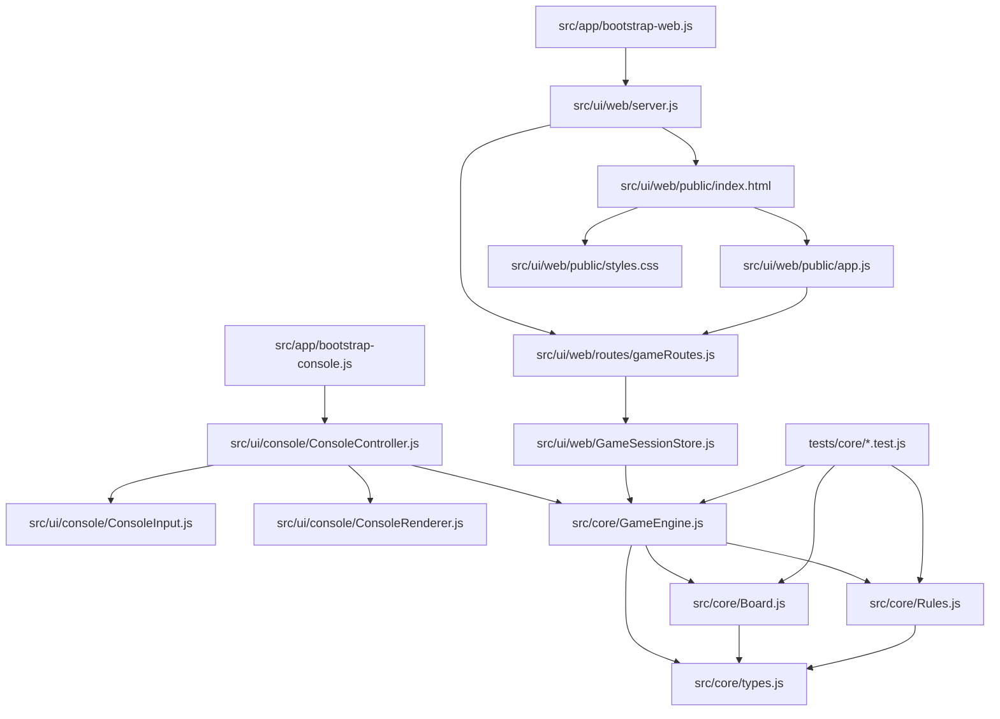
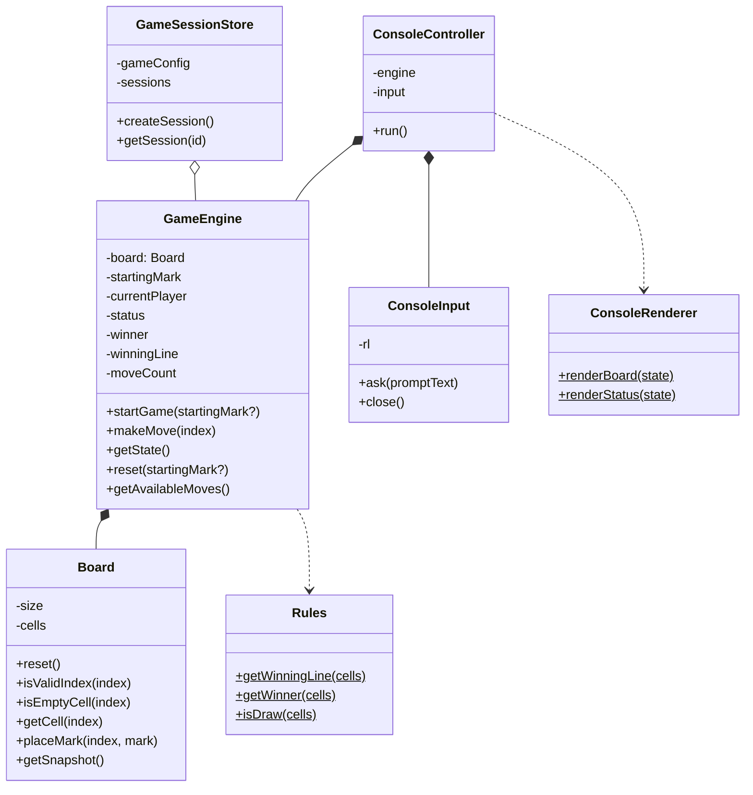
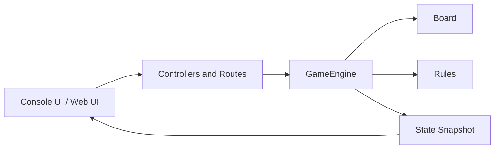

# Tic-Tac-Toe

## Project Status

Initial implementation is started with:

- Shared OOP game engine (`Board`, `Rules`, `GameEngine`)
- Console UI (interactive terminal play)
- Web UI (Express API + browser client)
- Core unit tests for engine behavior

## Quick Start

1. Install dependencies:
	- `npm install`
2. Run console UI:
	- `npm run start:console`
3. Run web UI:
	- `npm run start:web`
	- open `http://localhost:3000`
4. Run tests:
	- `npm test`

## Current Structure

- `src/core` — gameplay engine only (no UI)
- `src/ui/console` — terminal input/output and game loop
- `src/ui/web` — web server, API routes, static client
- `src/app` — bootstrap entry points and config
- `tests/core` — unit tests for engine logic

## Architecture Diagrams

### Module Relationships

### Class Relationships

### Dependency Flow

Tic-tac-toe is a classic two-player game played on a 3×3 grid. Players take turns placing their marks—`X` and `O`—into empty squares. The goal is to be the first to place three of your own marks in a straight line (horizontal, vertical, or diagonal).

## Basic Rules

- The game board has 9 spaces arranged in 3 rows and 3 columns.
- Two players alternate turns.
- One player uses `X`, the other uses `O`.
- A player wins by making a line of three matching marks.
- If all spaces are filled and no one has three in a row, the game is a draw.

## Turn Order Convention

There is no single universal rule for who starts first. A common convention (and the one used in many explanations) is that `X` moves first.

## Example Outcome

In a typical sample game, `X` can win in seven total moves.

## Strategy and Learning Value

Players quickly learn that perfect play from both sides always leads to a draw. Because of this, tic-tac-toe is often used to teach:

- good sportsmanship,
- strategic thinking,
- and introductory artificial intelligence concepts, especially game-tree search.

## Computational Perspective

Tic-tac-toe is simple enough to analyze completely:

- It has **765** essentially unique board positions (after accounting for symmetries).
- It has **26,830** possible games when counting unique play sequences up to rotations and reflections.

Since optimal play ends in a draw, tic-tac-toe is considered a solved game.

## Generalizations

Tic-tac-toe can be expanded in several ways:

- **m,n,k-game**: Players alternate on an `m × n` board and try to get `k` in a row.
- Standard tic-tac-toe is the **3,3,3-game**.
- It can be generalized further to higher-dimensional forms (for example, an `n`-dimensional variant).
- It can also be defined on arbitrary incidence structures, where points are cells and lines represent winning sets.

For standard tic-tac-toe, the incidence structure includes:

- 9 points (cells),
- 3 horizontal lines,
- 3 vertical lines,
- and 2 diagonal lines.
